  

# Hi 👋, Imma Roxy Mayford

### Informatics Engineering Student | Full Stack Web & Machine Learning (Currently Learning)

`> Just Code, Build & Keep Learning_`

Building modern, responsive full stack web applications while exploring the deep mechanics of Machine Learning & AI systems.

 

## 🚀 About Me

<table>
  <tr>
    <td width="65%" valign="top">

**Roxy Mayford**, an Informatics Engineering student deeply focused on **Full Stack Web Development** and **Machine Learning**.

I enjoy crafting scalable, modern web applications from intuitive frontends to reliable backends, while actively demystifying how mathematical theory powers intelligent AI & Machine Learning models.

Currently learning and actively building with:

🌐 **Full Stack Web**: React, Next.js, TypeScript, Tailwind CSS, Node.js, Express, PostgreSQL, MongoDB

🤖 **Machine Learning**: Python, NumPy, Pandas, Scikit Learn, PyTorch, TensorFlow

📐 **Foundational Math**: Linear Algebra, Multivariable Calculus, Probability, Optimization

My goal is simple: write clean code, build reliable software, and continuously evolve into a versatile engineer who creates meaningful, end to end systems.

   </td>
   <td width="35%" align="center" valign="middle">
     
      
     🌱 <i>Always evolving & leveling up!</i>
   </td>
  </tr>
</table>

 

  

  

## 🤝 Connect

  
  &nbsp;&nbsp;
  
  &nbsp;&nbsp;
  
  &nbsp;&nbsp;
  

 

## 💻 Tech Stack

  

  

 

## 📊 GitHub Stats

  

  

 

## 📈 Activity Graph

  

 

✨ <i>"Code with curiosity, learn with persistence, build with purpose."</i> / <b>Roxy Mayford</b>
